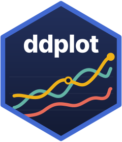

# ddplot 

<!-- badges: start -->
[](https://cran.r-project.org/package=ddplot)
[](https://cran.r-project.org/package=ddplot)
<!-- badges: end -->

`ddplot` turns a data frame into an interactive D3 SVG chart with a single R function. It has more than 40 chart types, from line and bar charts to chord diagrams and sunbursts, and they work in the RStudio viewer, R Markdown, Quarto and Shiny.

## Installation

You can install `ddplot` from CRAN with: 

``` r
install.packages("ddplot")
```

You can install the development version of `ddplot` from Github with:

``` r
remotes::install_github("feddelegrand7/ddplot")
```

## Usage 

- [Get started](https://feddelegrand7.github.io/ddplot/articles/Start.html)
- [Gallery of all the charts](https://feddelegrand7.github.io/ddplot/articles/gallery.html)
- [Reference](https://feddelegrand7.github.io/ddplot/reference/index.html)

## Code of Conduct

Please note that the ddplot project is released with a [Contributor Code of Conduct](https://contributor-covenant.org/version/2/0/CODE_OF_CONDUCT.html). By contributing to this project, you agree to abide by its terms.
